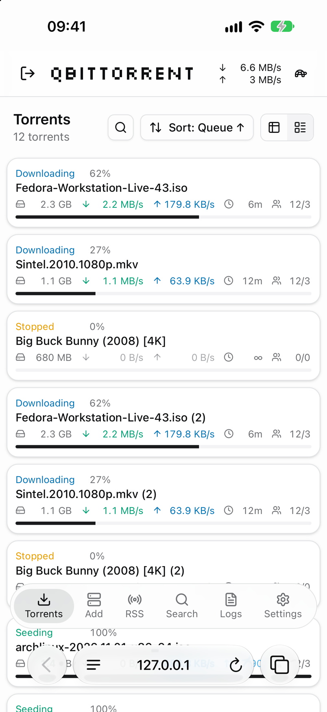

<p align="center">
  <picture>
    <source media="(prefers-color-scheme: dark)" srcset="docs/logo-dark.png">
    
  </picture>
</p>

# qbminimal

A minimal, phone-friendly Web UI for [qBittorrent](https://www.qbittorrent.org/). It replaces qBittorrent's built-in browser interface with a cleaner one that works just as well on a phone as on a desktop.

Built with React, TypeScript, Vite, and Tailwind CSS.

## Screenshots

On a desktop, as a table with a torrent's details below it, and as cards:

<p>
  
  
</p>

On a phone, as cards and as a table:

<p>
  
  
</p>

In Safari on an iPhone, where the list runs on behind the address bar:

<p>
  
</p>

## Features

- **Torrent list** as a table or as cards. In the table you can show, hide, drag, and resize columns, and sort by any of them. The layout is remembered on each device.
- **Filters** by name, status, category, tag, and tracker, each showing how many torrents it matches. Save a set of filters as a **view** to apply it again in one tap.
- **Torrent details**: pieces, transfer facts, files (choose what to download, rename, and save finished files with qBittorrent 5.3), trackers, peers with country flags, and every per-torrent setting: limits, location, queue, category, tags, and more.
- **Selecting and actions**: click a torrent to open its details in a panel below the list, Ctrl or Cmd-click and Shift-click to select several, and right-click for every action. On phones, tap a torrent for its details and hold one to start selecting.
- **Bulk actions** for several torrents at once, from the selection bar or the right-click menu.
- **Add torrents** from links or .torrent files with all of qBittorrent's options. Drop .torrent files anywhere on the page, or let the browser open magnet links here. **Create torrents** from files on the server.
- **RSS** feeds and folders, articles, and download rules, including import and export.
- **Search** with qBittorrent's search plugins, and plugin management.
- **Logs**, statistics with a live speed graph, connection status, and the alternative speed limit switch. A notice says when qBittorrent can't be reached.
- **Notifications** when a torrent finishes, if you turn them on.
- **Keyboard shortcuts** for the torrent list. Press `?` to see them.
- **Languages**: English, Arabic, Bengali, Chinese (Simplified and Traditional), Dutch, French, German, Hindi, Italian, Japanese, Korean, Portuguese (Portugal), Russian, Spanish (Spain), and Turkish, with the page mirrored for Arabic. The language follows the browser, or pick one in Settings.
- **Settings**: every qBittorrent preference, shown only when your qBittorrent version has it.
- A sidebar you can hide on wide screens.
- Light and dark themes that follow your device, and a layout made for phones, including when added to the home screen.

## Requirements

qBittorrent 5.0 or newer. A few features need a newer version and stay hidden or explain themselves on older ones: SSL settings for torrents need 5.1, reading .torrent files before adding them needs 5.2, and saving finished files from the browser needs 5.3.

## Installing

1. Download `qbminimal-release.zip` from the [latest release](https://github.com/kajover/qbminimal/releases/latest).
2. Unzip it. You get a folder named `qbminimal` with a `public` folder inside it.
3. Copy the `qbminimal` folder to the computer that runs qBittorrent.
4. In qBittorrent, open **Tools > Options > Web UI**, turn on **Use alternative Web UI**, and set **Files location** to the `qbminimal` folder. Choose the folder that contains `public`, not `public` itself.
5. Open the Web UI address in your browser and sign in with your qBittorrent username and password.

### Updating

1. Replace the contents of the `qbminimal` folder with the new release.
2. Restart qBittorrent, or turn **Use alternative Web UI** off, apply, and turn it on again. qBittorrent keeps the page in memory and only reads it again when the file looks newer than the copy it holds, and files unpacked from a zip keep the time they were built.
3. Reload the page. **Settings > App > About** shows the version that's running.

## Development

```bash
npm install
npm run dev
```

The dev server sends API requests under `/api` to qBittorrent at `http://localhost:8080`. Change `server.proxy` in `vite.config.ts` to point at yours.

Checks, also run by CI on every push and pull request:

```bash
npm run lint
npm test
npx tsc -b
```

## Translations

The text is translated with `t('English text')`, and each language is a file in `src/i18n` that maps the English text to its translation. To add a language, copy `src/i18n/de.ts`, translate the values, and add the language to `LANGUAGES` and `LOADERS` in `src/i18n/index.ts`. Keep each `{placeholder}` as it is. For a language written right to left, also add it to `RIGHT_TO_LEFT`; use start and end classes (`ps-2`, `text-end`) rather than left and right ones so the page mirrors.

Where qBittorrent's own translations have the same text, qbminimal uses their wording and terms, so the words match what you see in qBittorrent. The rest was machine translated and hasn't been reviewed by native speakers yet, so corrections are welcome.

`npm run i18n:check` lists text that a language doesn't cover yet.

## Building a release

```bash
npm run package
```

This builds into `release/public` and packs it as `qbminimal-release.zip`, the same layout the install steps describe.

Pushing a tag like `v1.1.0` that matches the version in `package.json` runs the same build on GitHub and publishes the zip and its SHA-256 checksum as a release.

`scripts/deploy.sh` copies a release to a server over SSH with `rsync`, then checks that the server is serving it. Put your settings in `.deploy.env`, which git ignores:

```bash
DEPLOY_TARGET=user@host:/path/to/qbminimal
DEPLOY_URL=https://example.com/qbittorrent/
```

Then run `npm run deploy` for the latest release, or `scripts/deploy.sh --zip qbminimal-release.zip` for a local build.

## Credits

Third-party components and their licenses are listed in [THIRD_PARTY_NOTICES.md](THIRD_PARTY_NOTICES.md).

## License

qbminimal is free software under the [GNU General Public License v3.0](LICENSE).
