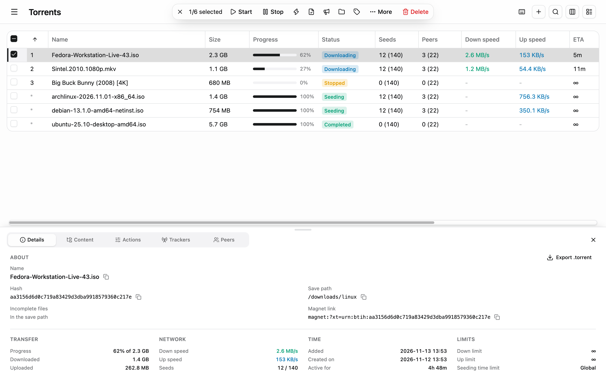
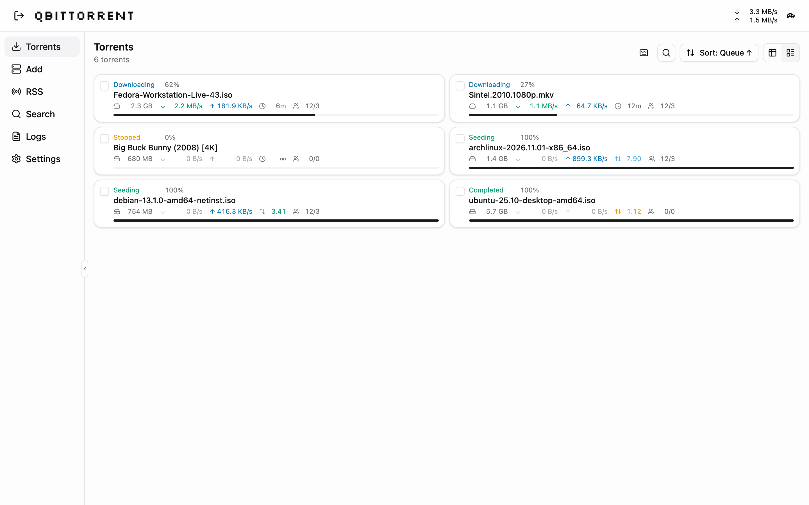
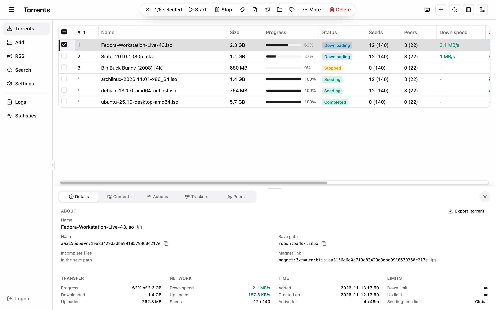
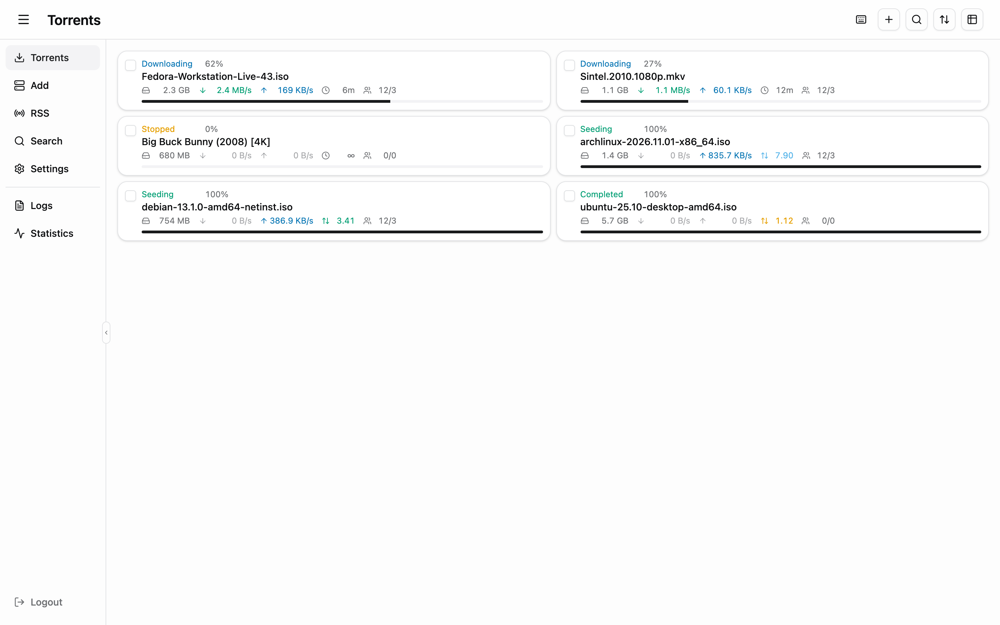
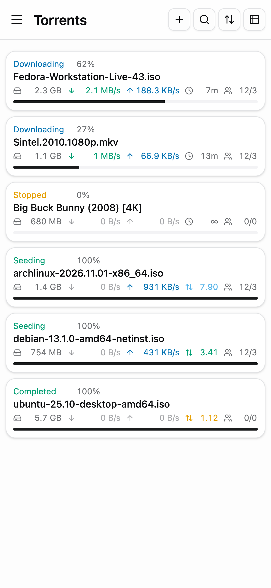
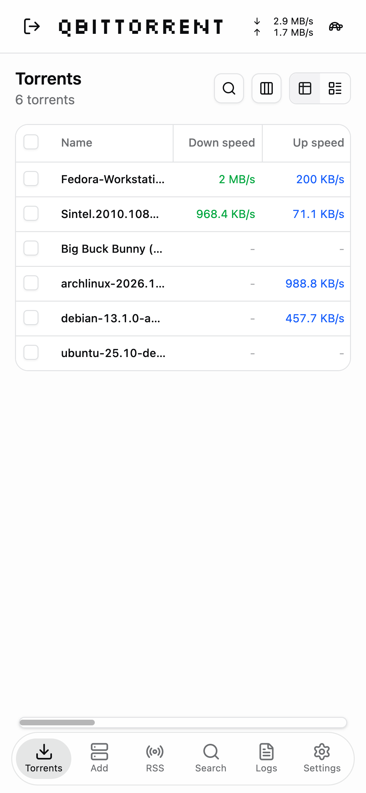
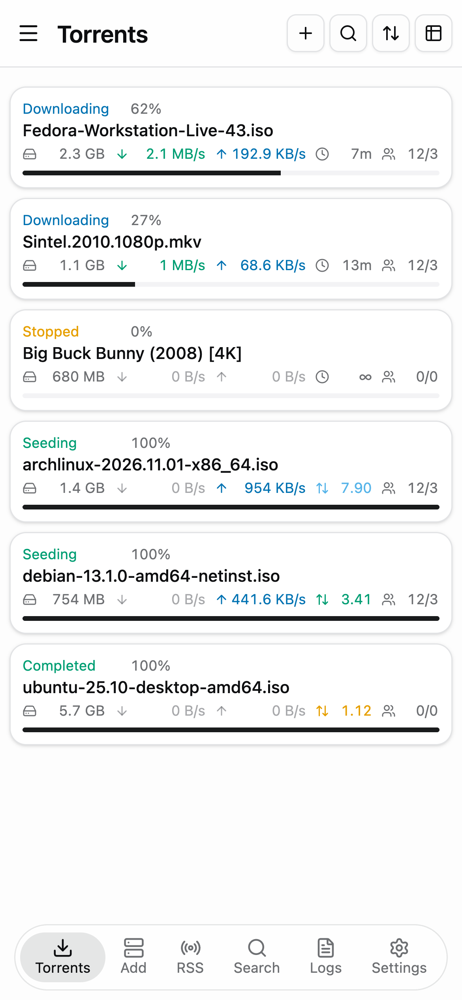
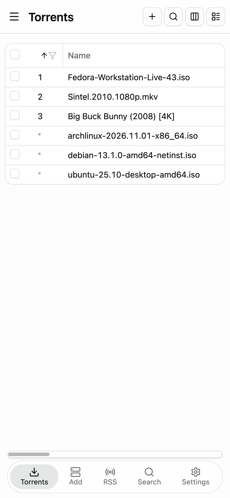

<p align="center">
  <picture>
    <source media="(prefers-color-scheme: dark)" srcset="docs/logo-dark.png">
    
  </picture>
</p>

# qbminimal

A minimal, phone-friendly Web UI for [qBittorrent](https://www.qbittorrent.org/). It replaces qBittorrent's built-in browser interface with a cleaner one that works just as well on a phone as on a desktop.

Built with React 19, TypeScript 7, Vite 8, and Tailwind CSS 4.

## Screenshots

On a desktop, as a table with a torrent's details below it, and as cards. Without the menu bar, the pages are in the menu button at the top left:

<p>
  
  
</p>

With the menu bar on, a sidebar holds the pages:

<p>
  
  
</p>

On a phone, as cards and as a table, without and with the tab bar:

<p>
  
  
  
  
</p>

## Features

- **Torrent list** as a table or as cards. In the table you can show, hide (also by right-clicking a header), drag, and resize columns, sort by any of them, and filter each one: a range of sizes, speeds, dates or ratios, text a name or path contains, or a set of states. The column titles stay in view while you scroll. The layout is remembered on each device.
- **Filters** by name, status, category, tag, and tracker, each showing how many torrents it matches. They start cleared on each visit; while any is on, the search button shows a dot and chips above the list name them. Save a set of filters as a **view** to apply it again in one tap.
- **Torrent details**: pieces, a speed graph, transfer facts with copy buttons for the name, hash, magnet link and paths, files (choose what to download and each file's priority, rename, and save finished files with qBittorrent 5.3), trackers, peers with country flags, and every per-torrent setting: limits, location, queue, category, tags, and more.
- **Selecting and actions**: click a torrent to open its details in a panel below the list, Ctrl or Cmd-click and Shift-click to select several, and right-click for every action, the everyday ones as a row of icons that name themselves on hover. Choose which actions sit in the selection bar from its More menu, separately for wide screens and phones. On phones, tap a torrent for its details and hold one to start selecting.
- **Bulk actions** for several torrents at once, from the selection bar or the right-click menu.
- **Add torrents** with the + button above the list or on the Add page, from links or .torrent files with all of qBittorrent's options. For a single magnet link or .torrent, see its files first and choose which to download. Drop .torrent files anywhere on the page, or let the browser open magnet links here. What you've entered stays while you visit other pages, until you add it or clear it with the ×. **Create torrents** from files on the server.
- **RSS** feeds and folders, articles, and download rules, including import and export.
- **Search** with qBittorrent's search plugins, results you can sort and filter by column, and plugin management.
- **Logs**, statistics with a live speed graph, connection status, storage, and the switch for the alternative speed limits. Open **Logs** and **Statistics** from the menu, where they sit together below the pages, or from the sidebar; the speeds in the header open the statistics too. A notice says when qBittorrent can't be reached.
- **Notifications** when a torrent finishes, if you turn them on.
- **Keyboard shortcuts** for the torrent list. Press `?` to see them.
- **30 languages**, listed [below](#languages).
- **Accessibility options**, described [below](#accessibility).
- **Settings**: every qBittorrent preference, shown only when your qBittorrent version has it.
- A sidebar you can hide on wide screens.
- Light and dark themes that follow your device, and a layout made for phones, including when added to the home screen. The header holds each page's title and buttons, and a menu button holds the pages, Logs, Statistics, and logout, which leaves the list as much room as possible. Under **Settings > App > Appearance** you can show the current speeds in the header, and turn on **Menu bar** to also show the pages in a sidebar on wide screens and in a tab bar on phones (Logs stays in the menu there).
- **Update check**: every 12 hours, in the background after signing in, the app asks GitHub for new qbminimal and qBittorrent releases, and **Settings > App > About** shows what it found.

## Accessibility

- **Text size**: Small, Default, Large, or Larger under **Settings > App > Appearance**. Spacing, icons, and table columns grow with the text, and the sizes build on the browser's own text size, so a larger default set there still counts. On iPhone and iPad you can still pinch to zoom.
- **Color-blind-safe colors** are applied throughout: every status, speed, ratio, and pieces color comes from the [Okabe–Ito](https://jfly.uni-koeln.de/color/) set (bluish green, blue, orange, and vermillion), chosen to stay easy to tell apart with any kind of color blindness. Colors never carry meaning alone either: statuses have labels, speeds have arrows, the upload line in the speed graph is dashed, and pieces being downloaded are striped.
- **Screen readers** hear when the selection, the sort order, the view, or the number of matching torrents changes. Icon buttons have names, and the tab bar's names stay readable to screen readers when they are hidden on screen.
- **Tab bar labels** can be turned off on phones under **Settings > App > Appearance**, leaving larger icons.
- **Keyboard shortcuts** for the torrent list. Press `?` to see them.

## Languages

| Language | Shown as | Improve it |
| --- | --- | --- |
| English | English | The original |
| Arabic | العربية | [Edit ar.json](https://github.com/kajover/qbminimal/edit/main/src/i18n/locales/ar.json) |
| Bengali | বাংলা | [Edit bn.json](https://github.com/kajover/qbminimal/edit/main/src/i18n/locales/bn.json) |
| Bulgarian | Български | [Edit bg.json](https://github.com/kajover/qbminimal/edit/main/src/i18n/locales/bg.json) |
| Chinese (Simplified) | 中文（简体） | [Edit zh-Hans.json](https://github.com/kajover/qbminimal/edit/main/src/i18n/locales/zh-Hans.json) |
| Chinese (Traditional) | 中文（繁體） | [Edit zh-Hant.json](https://github.com/kajover/qbminimal/edit/main/src/i18n/locales/zh-Hant.json) |
| Czech | Čeština | [Edit cs.json](https://github.com/kajover/qbminimal/edit/main/src/i18n/locales/cs.json) |
| Dutch | Nederlands | [Edit nl.json](https://github.com/kajover/qbminimal/edit/main/src/i18n/locales/nl.json) |
| French | Français | [Edit fr.json](https://github.com/kajover/qbminimal/edit/main/src/i18n/locales/fr.json) |
| German | Deutsch | [Edit de.json](https://github.com/kajover/qbminimal/edit/main/src/i18n/locales/de.json) |
| Greek | Ελληνικά | [Edit el.json](https://github.com/kajover/qbminimal/edit/main/src/i18n/locales/el.json) |
| Hebrew | עברית | [Edit he.json](https://github.com/kajover/qbminimal/edit/main/src/i18n/locales/he.json) |
| Hindi | हिन्दी | [Edit hi.json](https://github.com/kajover/qbminimal/edit/main/src/i18n/locales/hi.json) |
| Hungarian | Magyar | [Edit hu.json](https://github.com/kajover/qbminimal/edit/main/src/i18n/locales/hu.json) |
| Indonesian | Bahasa Indonesia | [Edit id.json](https://github.com/kajover/qbminimal/edit/main/src/i18n/locales/id.json) |
| Italian | Italiano | [Edit it.json](https://github.com/kajover/qbminimal/edit/main/src/i18n/locales/it.json) |
| Japanese | 日本語 | [Edit ja.json](https://github.com/kajover/qbminimal/edit/main/src/i18n/locales/ja.json) |
| Korean | 한국어 | [Edit ko.json](https://github.com/kajover/qbminimal/edit/main/src/i18n/locales/ko.json) |
| Persian | فارسی | [Edit fa.json](https://github.com/kajover/qbminimal/edit/main/src/i18n/locales/fa.json) |
| Polish | Polski | [Edit pl.json](https://github.com/kajover/qbminimal/edit/main/src/i18n/locales/pl.json) |
| Portuguese (Brazil) | Português (Brasil) | [Edit pt-BR.json](https://github.com/kajover/qbminimal/edit/main/src/i18n/locales/pt-BR.json) |
| Portuguese (Portugal) | Português (Portugal) | [Edit pt.json](https://github.com/kajover/qbminimal/edit/main/src/i18n/locales/pt.json) |
| Romanian | Română | [Edit ro.json](https://github.com/kajover/qbminimal/edit/main/src/i18n/locales/ro.json) |
| Russian | Русский | [Edit ru.json](https://github.com/kajover/qbminimal/edit/main/src/i18n/locales/ru.json) |
| Spanish (Spain) | Español | [Edit es.json](https://github.com/kajover/qbminimal/edit/main/src/i18n/locales/es.json) |
| Swedish | Svenska | [Edit sv.json](https://github.com/kajover/qbminimal/edit/main/src/i18n/locales/sv.json) |
| Thai | ไทย | [Edit th.json](https://github.com/kajover/qbminimal/edit/main/src/i18n/locales/th.json) |
| Turkish | Türkçe | [Edit tr.json](https://github.com/kajover/qbminimal/edit/main/src/i18n/locales/tr.json) |
| Ukrainian | Українська | [Edit uk.json](https://github.com/kajover/qbminimal/edit/main/src/i18n/locales/uk.json) |
| Vietnamese | Tiếng Việt | [Edit vi.json](https://github.com/kajover/qbminimal/edit/main/src/i18n/locales/vi.json) |

The language follows the browser, or pick one under **Settings > App > Appearance**. For Arabic, Hebrew, and Persian the page is mirrored, right to left. See [Translations](#translations) to correct one or add one: no programming needed.

## Requirements

qBittorrent 5.0 or newer. A few features need a newer version and stay hidden or explain themselves on older ones: SSL settings for torrents need 5.1, seeing a torrent's files before adding it needs 5.2, and saving finished files from the browser needs 5.3.

## Installing

1. Download `qbminimal-release.zip` from the [latest release](https://github.com/kajover/qbminimal/releases/latest).
2. Unzip it. You get a folder named `qbminimal` with a `public` folder inside it.
3. Copy the `qbminimal` folder to the computer that runs qBittorrent.
4. In qBittorrent, open **Tools > Options > Web UI**, turn on **Use alternative Web UI**, and set **Files location** to the `qbminimal` folder. Choose the folder that contains `public`, not `public` itself.
5. Open the Web UI address in your browser and sign in with your qBittorrent username and password.

### Updating

1. Replace the contents of the `qbminimal` folder with the new release.
2. Restart qBittorrent, or turn **Use alternative Web UI** off, apply, and turn it on again. qBittorrent keeps the page in memory and only reads it again when the file looks newer than the copy it holds, and files unpacked from a zip keep the time they were built.
3. Reload the page. **Settings > App > About** shows the version that's running.

## Development

Needs Node.js 26 or newer.

```bash
npm install
npm run dev
```

The dev server sends API requests under `/api` to qBittorrent at `http://localhost:8080`. Change `server.proxy` in `vite.config.ts` to point at yours.

Checks, also run by CI on every push and pull request:

```bash
npm run lint
npm test
npm run typecheck
```

`npm run typecheck` uses TypeScript 7. The linter uses TypeScript 6.0 until typescript-eslint supports 7. Dependabot checks every week for newer packages and GitHub Actions and opens pull requests for them.

## Translations

Help with translations is very welcome, and needs no programming: each language is one JSON file in [`src/i18n/locales`](src/i18n/locales) that you can edit right on GitHub. The **Edit** links in the [language list](#languages) open your language's file. Change the text on the right of each colon and propose the change; a check on the pull request names anything it can't use. [CONTRIBUTING.md](CONTRIBUTING.md#translations) has the few rules, and how to add a new language. You can also [report a wrong translation](https://github.com/kajover/qbminimal/issues/new?template=translation.yml) without editing anything.

Where qBittorrent's own translations have the same text, qbminimal uses their wording and terms, so the words match what you see in qBittorrent. The rest was machine translated and hasn't been reviewed by native speakers yet.

`npm run i18n:check` lists text that a language doesn't cover yet, and lines whose `{placeholders}` don't match.

## Building a release

```bash
npm run package
```

This builds into `release/public` and packs it as `qbminimal-release.zip`, the same layout the install steps describe.

Pushing a tag like `v1.1.0` that matches the version in `package.json` runs the same build on GitHub and publishes the zip and its SHA-256 checksum as a release.

`scripts/deploy.sh` copies a release to a server over SSH with `rsync`, then checks that the server is serving it. Put your settings in `.deploy.env`, which git ignores:

```bash
DEPLOY_TARGET=user@host:/path/to/qbminimal
DEPLOY_URL=https://example.com/qbittorrent/
```

Then run `npm run deploy` for the latest release, or `scripts/deploy.sh --zip qbminimal-release.zip` for a local build.

## Credits

qbminimal is influenced by [qbitWebber](https://github.com/ksuaning-au/qbitWebber), the project it started from, and by [qui](https://github.com/autobrr/qui), whose torrent table, column filters and details panel inspired qbminimal's.

Third-party components and their licenses are listed in [THIRD_PARTY_NOTICES.md](THIRD_PARTY_NOTICES.md).

## License

qbminimal is free software under the [GNU General Public License v3.0](LICENSE).
